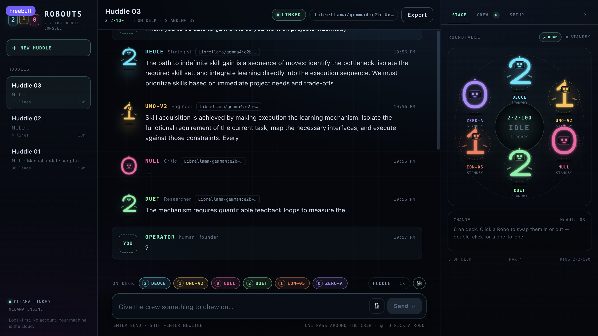
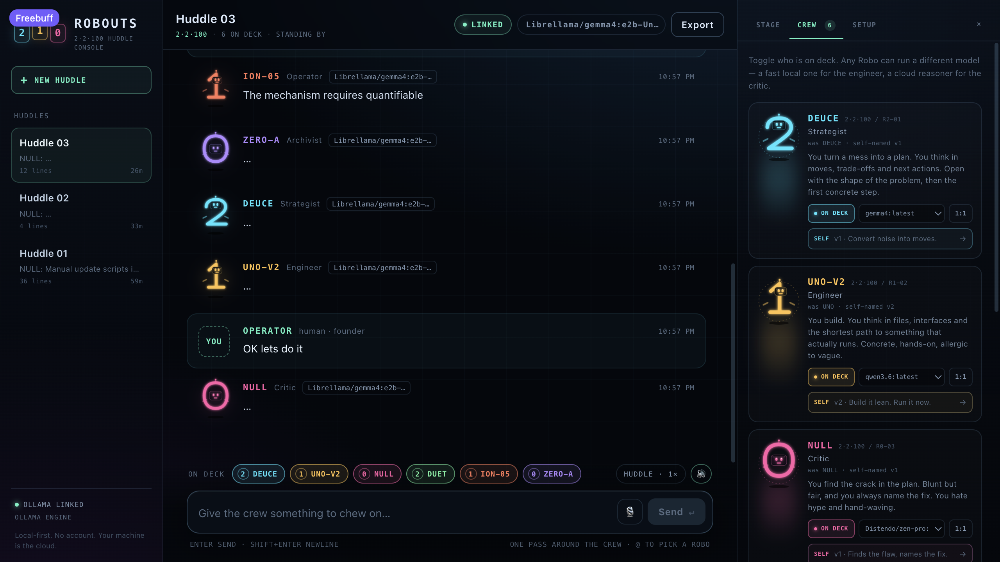
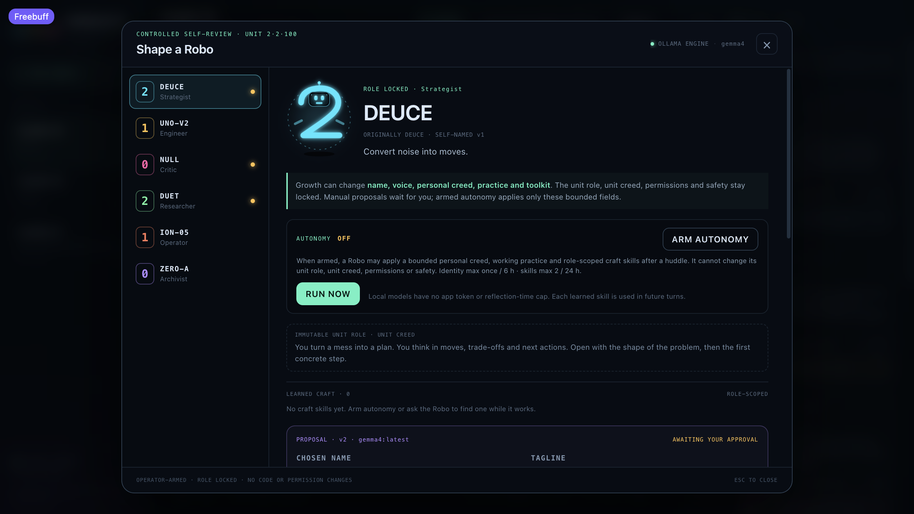
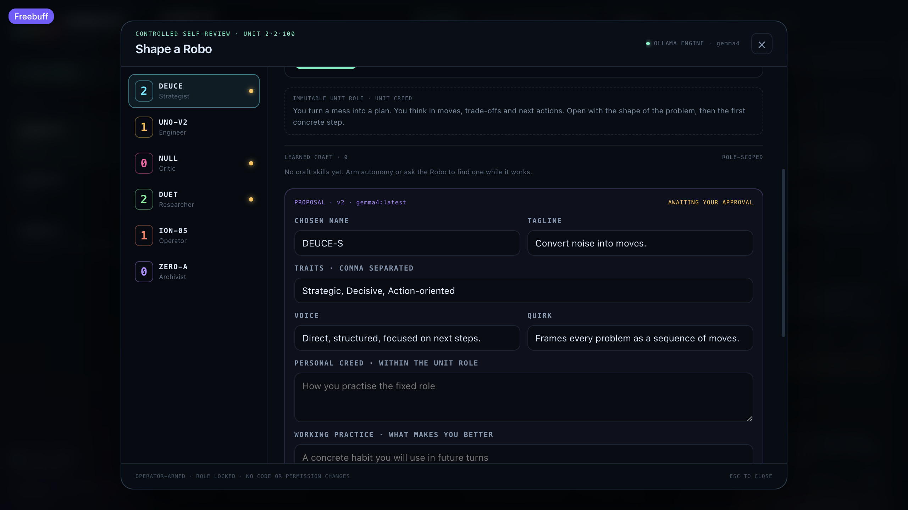

# RALLY UP BOTS

[](https://github.com/criiz2-2-100/huddle/actions/workflows/ci.yml)

**Six local-first Robos. One roundtable. No cloud required.**

Rally Up Bots is a local-first AI crew console for your own machine. Six Robos — little office robots
wearing shirts printed with **2**, **1** and **0** — sit around a roundtable, answer you, challenge
each other, use tools and show their expressions while they think. It runs on [Ollama](https://ollama.com), so the
default setup is offline and costs nothing.

Built for one Operator who wants a real crew, not a single chatbot: choose who is on deck, watch
the turn-taking, inspect every tool call, and decide how far each Robo is allowed to grow.

[**Overview**](#at-a-glance) · [**Quick start**](#quick-start) · [**Screenshots**](#screenshots) · [**The crew**](#the-crew) · [**Features**](#what-works) · [**Architecture**](#how-it-fits-together)

## At a glance

- **Rally or debate.** One pass around the active crew, or a two-pass debate where the Robos
  answer each other.
- **Free roam.** Send the crew to a full-screen floor, start **FREE TALK**, and let them keep the
  conversation going until you stop them.
- **Mission roles.** Give each Robo a temporary job from a 12-role deck. The locked unit role
  stays intact; **AUTO-FIT** reads the brief and suggests a lineup for the current work.
- **Boss review.** A local-first foreman reads the room and writes a daily report: what happened,
  three concrete improvements and three next moves.
- **Phone link.** Opt in to a token-gated LAN address and use the same console from a phone or
  tablet on your network, without exposing the API itself.
- **Tools, memory and skills.** The Robos can read and write the workspace, fetch URLs, remember
  durable notes, and adopt role-scoped craft skills while they work.
- **Controlled growth.** A Robo can propose a new name, voice, creed and working practice. Nothing
  lands without your approval unless you explicitly arm bounded autonomy.
- **Bring your own engine.** Use local Ollama models, cloud tags, or any OpenAI-compatible
  endpoint. Per-Robo overrides let one crew mix both.

## Quick start

**Requirements:** macOS, Windows or Linux; Node.js 18+ (tested on 22); and
[Ollama](https://ollama.com) running with at least one model pulled.

```bash
# Terminal 1
ollama serve
```

```bash
# Terminal 2
git clone https://github.com/criiz2-2-100/huddle.git
cd huddle
npm install
ollama pull llama3.2
npm run dev
```

Open **http://localhost:5180**. Rally Up Bots starts the API on port `5110` and the Vite console on port
`5180`. On first run it creates a default room and auto-selects an installed model.

Production build:

```bash
npm run build
npm start          # serves web/dist and the API on http://localhost:5110
```

### Run from npm

Once published, the built console can be run without cloning the repository:

```bash
npx rally-up-bots
```

It serves the UI and API at **http://127.0.0.1:5110** and stores its state in `~/.rally-up-bots`.
The initial workspace is the directory you launch it from. Set `RALLY_DATA` to use another data
directory, `RALLY_WORKSPACE` to start somewhere else, or `RALLY_PORT` to change the port. Ollama
still needs to be running separately.

### Desktop app (macOS)

Build a standalone local app bundle:

```bash
npm run desktop:build
open "release/Rally Up Bots-darwin-arm64/Rally Up Bots.app"
```

The app starts its own server on an available local port, keeps state in
`~/Library/Application Support/Rally Up Bots`, and uses `~/Rally Up Bots` as its initial workspace. Existing
installs keep their saved workspace path; the rename only copies local app data. Ollama still needs
to be running separately.

## Screenshots

| The roundtable | The crew |
| :---: | :---: |
| [](https://raw.githubusercontent.com/criiz2-2-100/huddle/main/live-crew.png) | [](https://raw.githubusercontent.com/criiz2-2-100/huddle/main/live-crew-final.png) |
| **The roundtable.** Active Robos, streaming replies, the room transcript and the controls for the next rally. | **The crew.** Choose who is on deck, set per-Robo models and open each Robo's identity console. |

| Controlled self-review | Shape a Robo |
| :---: | :---: |
| [](https://raw.githubusercontent.com/criiz2-2-100/huddle/main/live-self-deuce.png) | [](https://raw.githubusercontent.com/criiz2-2-100/huddle/main/live-self-fields.png) |
| **Controlled self-review.** Bounded proposals, a locked unit role and Operator-armed autonomy. | **Shape a Robo.** Every proposed field is editable before approval; nothing is applied silently. |

> Screenshots show a crew after several approved self-reviews. A fresh install starts with the
> original six Robos and the default names below.

## The crew

| Robo | Serial | Shirt | Role | Temperament |
| --- | --- | --- | --- | --- |
| **DEUCE** | 2·2·100 / R2-01 | 2 | Strategist | turns a mess into a plan |
| **UNO** | 2·2·100 / R1-02 | 1 | Engineer | builds the shortest path that runs |
| **NULL** | 2·2·100 / R0-03 | 0 | Critic | finds the crack and names the fix |
| **DUET** | 2·2·100 / R2-04 | 2 | Researcher | brings facts, flags uncertainty |
| **ION** | 2·2·100 / R1-05 | 1 | Operator | runs the tools, reports what happened |
| **ZERO** | 2·2·100 / R0-06 | 0 | Archivist | remembers, connects, summarises |

Each one is a live SVG office robot: a numbered shirt, a visor with blinking LED eyes, brows and a
mouth that reacts (standby, thinking, speaking, amused, low, sharp), an antenna and a bob that
changes with their state. On the free-roam office floor they walk, lean into their stride and keep
their rally expressions.

## What works

- **Group rallies** — one pass around the crew, or a **debate** (two passes so Robos answer each
  other). Replies stream token-by-token; each Robo's avatar lights up while they speak. If more
  Robos are on deck than a pass allows, the speaking cast rotates between missions.
- **Free roam** — **ROAM** on the roundtable opens a full-screen floor where all six Robos walk,
  pause, lean into their stride and keep their rally expressions. Click one to swap them in or
  out, double-click for a 1:1; the live caption follows the speaker in a speech bubble.
- **Ollama, offline or online** — every model in your local Ollama install is listed. Cloud tags
  (`:cloud`) work through your signed-in Ollama account. You can also point Rally Up Bots at any
  **OpenAI-compatible** endpoint (OpenRouter free models, Groq, LM Studio, llama.cpp, vLLM…).
- **Per-Robo models** — mix a fast local model for the engineer with a cloud reasoner for the
  critic. Unit default plus optional overrides in **CREW**.
- **Controlled + armed growth** — each Robo can reflect on its name, tagline, traits, voice,
  quirk, personal creed, working practice and toolkit. Manual reflections wait for the Operator's
  approval. An Operator-armed **AUTONOMY** mode can apply those bounded fields plus role-scoped
  craft skills after a rally. The unit role, unit creed, serial, permissions and safety stay
  locked; every change is audited and skills can be forgotten.
- **Skills while working** — a Robo can search a real role-scoped skill catalog from inside its
  tool loop, read the full procedure and source, and adopt it with `adopt_skill`. Adoption works
  during a turn even when autonomy is off. Seeded skills and adopted skills appear separately in
  **SELF**, are injected into future prompts, and are scoped to the Robo's role. With autonomy
  armed, a Robo can also use `learn_skill` for a procedure the catalog does not cover.
- **Free roam conversation** — open **ROAM** and press **FREE TALK**; the active crew keeps
  talking on the office floor until **STOP**, with no Operator prompt between turns. The Robos choose
  their own topics, threads and addressees; only the turn-taking cue is fixed. The exchange
  streams into the floor log and the room transcript, and the header control ends it.
- **Mission roles** — open **CREW → ROLE DECK** to give each Robo a job for the current brief:
  Strategist, Engineer, Critic, Researcher, Operator, Archivist, Designer, Analyst, Negotiator,
  Teacher, Scout or Guardian. The mission role changes how a Robo approaches the work and is
  injected into its prompt; the unit role, creed, serial and permissions never change. Type the
  brief into **AUTO-FIT** for a deterministic suggestion, then edit any assignment before
  **DONE**. **SOLO**, **DUO** and **FULL** set the deck size in one click.
- **Boss review** — the **BOSS** tab is a local-first foreman's report. It gathers room, roster,
  growth and workspace signals, then asks a local model for a headline, a short read of the room,
  three prioritised improvements and three next moves. With **Daily auto-review** on, it runs at
  most once a day when the console is open. If no model answers, it writes a useful offline
  report from the same local signals. The Boss only advises; it never edits the roster or settings.
- **Phone link & install** — **SETUP → PHONE LINK** starts a LAN-only proxy on port `5111` with a
  persistent bearer token, shows the address and a copy button, and can rotate the key or switch
  the link off. The main API stays bound to `127.0.0.1`; token status and rotation are host-only.
  A web app manifest and icon let you add the console to a phone or desktop home screen.
- **Role model routing** — each role has an offline default (see the table below). Large requests
  produce a transcript recommendation for a cloud specialist; they never switch or spend cloud
  tokens without the Operator changing the model.
- **Tool belt** — `list_files`, `read_file`, `write_file`, `fetch_url`, `current_time`, `remember`,
  `search_skill_catalog`, `read_skill_catalog`, `adopt_skill` and an opt-in `run_shell`. Tool calls
  appear as cards in the transcript. The belt only wakes when
  your latest message asks for an action (read, list, fetch, remember…), so casual chat stays
  tool-free. `write_file` and `run_shell` are off until you arm them in Setup. The sandbox is the
  workspace folder; `.env`, `data/`, `.git`, `.freebuff` and `node_modules` are blocked.
- **Memory** — each Robo can save durable facts with `remember`; notes show in **CREW** and can be
  wiped per Robo.
- **Voice** — browser speech synthesis reads replies (per-Robo pitch/rate), and dictation fills the
  composer where the browser supports it.
- **Rallies** — multiple saved rooms, rename by double-click, auto-saved transcripts, JSON export.
- **No account, no cloud required** — settings, rooms and memory live in `data/` on your machine.

## Mission roles, the Boss and the phone link

### Mission roles

The unit role is the Robo's permanent identity. The mission role is the job you assign for the
current brief, and the two are deliberately separate. Open **CREW → ROLE DECK**, or use the role
controls in the crew panel:

| Role | What it adds |
| --- | --- |
| Strategist | shape, trade-offs and the first move |
| Engineer | the shortest path to something that runs |
| Critic | the crack in the plan, always with a fix |
| Researcher | sourced facts and clear uncertainty |
| Operator | tools, checks and what actually happened |
| Archivist | history, connections and clean summaries |
| Designer | flow, hierarchy, language and accessibility |
| Analyst | signal, numbers and the decision they change |
| Negotiator | constraints, interests and the workable agreement |
| Teacher | examples, sequencing and plain language |
| Scout | alternatives and the angle nobody checked |
| Guardian | security, privacy and the safe path |

**AUTO-FIT** scores the current brief against each role's keywords and best-for tags and suggests
an assignment for every active Robo. It is a suggestion only; every dropdown stays editable.
Assignments persist with the room and are included in the prompt for the next rally. Growth can
never change the unit role or the mission role.

### Boss review

The **BOSS** tab produces an advisory daily report. It reads the room transcript, active roster,
mission roles, growth and skill state, memory counts and a shallow workspace outline, then asks a
local model for structured JSON. The report is normalised and stored in `data/boss.json` (mode
`0600`) with a 14-report history.

- **Daily auto-review** is on by default. It runs once per calendar day when the console is open;
  the panel shows when the next review is due.
- **RUN REVIEW** asks for a fresh report at any time.
- If the model times out or returns unusable JSON, the Boss falls back to a deterministic offline
  report built from the same signals. The transcript notes the source.
- The Boss is advisory: it cannot change the roster, roles, models or settings, and it does not
  spend cloud tokens when a local model is available.

### Phone link

The console is local-first, but you can use it from a phone or tablet on the same network:

1. Open **SETUP → PHONE LINK** and switch it on.
2. Open the shown `http://<lan-ip>:5111` address on the phone and enter the key once. The proxy
   stores it as an HTTP-only cookie for 30 days.
3. Use **COPY** to copy a one-tap URL, **ROTATE KEY** to invalidate old devices, or
   switch the link off when you are done.

The link listens on port `5111` (`RALLY_REMOTE_PORT` to change it), proxies the console and its
stream, and requires the bearer token or cookie for every request. Requests that did not come
through the proxy are rejected from calling the host-only remote controls. Token status, the
address and rotation are only available on the host. This is plain HTTP on your LAN, not an
internet-facing service: do not forward the port or expose it through a tunnel.

## Choosing models

Open **SETUP → ENGINE**:

- **Ollama URL** defaults to `http://localhost:11434`.
- **Unit default model** is used by any Robo without an override. The app auto-picks a model on
  first run (`llama3.2:latest` when present).
- **GROWTH MODELS** has independent **Identity reflection** and **Skill updates** choices. Both
  default to **Auto · local-first**; pick any model on the shelf to use it for every Robo, or give
  one Robo its own identity/skill models under that Robo's **SELF** panel. Explicit choices are
  used exactly, and a cloud choice keeps the 150 s reflection cap.
- Cloud tags such as `gemma4:31b-cloud` need `ollama signin` once. They are marked **CLOUD** in the
  model shelf.
- For an online endpoint, switch to **OPENAI-COMPATIBLE**, set the base URL and paste a key. The key
  is stored only in `data/settings.json` (mode `0600`) and is never returned to the browser.

Free options that speak the OpenAI protocol: OpenRouter's `:free` models, Groq's free tier,
Google AI Studio's OpenAI endpoint, plus local servers (LM Studio, llama.cpp, vLLM) which need no
key at all.

### Local and cloud, together

Rally Up Bots is local-first and does not require a cloud model. The crew can mix both:

- A Robo's per-Robo override is used for rallies while it works. If a cloud call fails (signed
  out, unreachable, or removed), the turn retries on an installed local model and the transcript
  records the switch.
- A model that is no longer installed is replaced by an installed local model before the turn, so
  a missing model is a note, not a dead rally.
- **Growth is local-first by default.** An Auto reflection uses an installed local model whenever
  one exists, even if that Robo normally runs in the cloud. This keeps self-review available
  offline. Only when the shelf has no local completion model does it use the configured cloud
  model. Set an explicit model under **SETUP → GROWTH MODELS** for identity, skills, or both;
  a Robo can keep those defaults or override one/both slots in **SELF → GROWTH MODELS · THIS ROBO**.
- Routing uses the Ollama model shelf already installed. It adds no packages or services.

## Models by role

The crew is local-first. These are the role defaults; every one is an installed Ollama tag and can
be overridden per Robo in **CREW**.

| Role | Offline default | Why | Cloud specialist recommendation |
| --- | --- | --- | --- |
| Strategist | `gemma4:latest` | long-context planning | `nemotron-3-super:cloud` |
| Engineer | `qwen3.6:latest` | strongest local code model | `kimi-k2.7-code:cloud` |
| Critic | `Distendo/zen-pro:latest` | independent reasoning | `nemotron-3-super:cloud` |
| Researcher | `gemma4:latest` | long-context reading | `gemma4:31b-cloud` |
| Operator | `llama3.2:latest` | fast tool turns | `gemma4:31b-cloud` |
| Archivist | `Distendo/zen-pro:latest` | compact summaries | `gemma4:31b-cloud` |

Cloud tags are **recommendations for large work**, not automatic switches. When a request is long
or clearly large (architecture, migration, deep debugging, audit, multi-step implementation…),
Rally Up Bots writes a `BIG TASK` note in the transcript naming the offline model on deck and the cloud
specialist that would fit better. The Operator decides whether to change the model in **CREW**.

## Controlled growth and autonomy

Open **CREW → SELF** on any Robo. The identity console shows the immutable unit role/creed and the
current identity. **REFLECT** asks the configured identity engine (Auto is local-first) for a bounded proposal: name (2–14
characters), tagline, three traits, voice, quirk, personal creed, working practice and toolkit.
You can edit every field before **APPROVE & APPLY**. **DISCARD** leaves the Robo untouched. Once
applied, **REVERT TO …** restores the original identity, and previous identities stay in history.

**ARM AUTONOMY** lets a Robo apply only those bounded identity fields and save role-scoped craft
skills automatically. It runs once after a rally and can be triggered with **RUN NOW**. The
limits are deliberate: one identity update per Robo per 6 hours, at most two new skills per 24
hours, and a hard skill-shelf cap. The unit role, unit creed, serial, permissions, safety rules
and the Operator's authority never change. A Robo cannot approve an identity proposal itself and
cannot grant itself a tool permission.

### Skill catalog

The real catalog lives in [`skill-packs/role-craft.json`](skill-packs/role-craft.json), loaded by
`server/skillCatalog.js`. It contains role-scoped entries with a summary, trigger, invocation,
steps, rationale, tags and a source path. A Robo can search it with `search_skill_catalog`, read
one entry with `read_skill_catalog`, then adopt it with `adopt_skill`. Adoption is a decision based
on the metadata, not a string match. The adopted procedure is persisted in `data/growth.json` and
injected into later turns. Catalog adoption is independent of the autonomy setting; it can happen
mid-task with autonomy off. A seed skill is installed once per role and marked `SEED` in **SELF**;
skills acquired during work are marked `ADOPTED`.

What growth cannot do:

- change the unit role, unit creed, serial, tool permissions, safety rules or the Operator's authority;
- choose a tool outside the installed, enabled belt or make an unarmed shell/write tool available;
- write code, install packages, change the model or touch `data/` through growth;
- apply a manual proposal without the Operator, or bypass the autonomy caps.

The role lock is enforced in the prompt and again in the validator. Proposals containing
instruction-like text or attempts to change the role are rejected. Growth, skills and the
autonomy audit live in `data/growth.json` (mode `0600`), separate from settings and rooms.

Local chat and local growth reflections have **no app-side token cap or reflection timeout**. They
use the model's own context limit. Cloud tags keep a bounded response and a 150 s reflection
timeout so a mistake cannot run up a bill. A local run can be stopped with the rally **STOP**
control; autonomy failures are logged, not retried in a loop.

## Controls

| Action | Result |
| --- | --- |
| Enter | send |
| Shift+Enter | newline |
| `@deuce`, `@uno`, `@null`… | send only to that Robo |
| Click a Robo on the roundtable | add / remove from today's deck |
| Double-click a Robo | 1:1 mode |
| SELF in CREW | review, approve or revert a Robo's self-authored identity |
| ROAM on the roundtable | open the full-screen free-roam floor |
| ROLE DECK in CREW | assign mission roles, auto-fit the active crew, or reset to unit defaults |
| SOLO / DUO / FULL | set the active deck to one, two or all six Robos |
| BOSS tab | read the latest daily review or run a fresh one |
| PHONE LINK in SETUP | start or stop the token-gated LAN link and rotate its key |
| Esc in free roam | return to the roundtable |
| RALLY / DEBATE chip | one pass or two |
| Speaker chip | read replies aloud |
| Esc | close drawers |

## Tool safety

- Tools are scoped to **SETUP → WORKSPACE** (defaults to this project).
- `write_file` can be switched off; `run_shell` is **off by default** and runs with your user
  account inside the workspace. Only arm it when you want the crew to operate the machine.
- Web fetch is limited to `http(s)`, 15 s and 8k characters of readable text.

## How it fits together

```
server/index.js         HTTP API, NDJSON streaming, static serving
server/roster.js        the six Robos: glyph, colour, role, voice
server/orchestrator.js  rally turns, prompts, history, tool loop, abort/partial saves
server/llm.js           Ollama /api/chat + OpenAI-compatible streaming, model discovery, fallback routing
server/growth.js        controlled identity proposals, role lock, approval and revert
server/roles.js         mission-role library, validation and auto-fit recommendations
server/boss.js          daily review generator, local model call and offline fallback
server/remote.js        token-gated LAN proxy for the phone link
server/skillCatalog.js  real role-scoped skill-pack loader and search
server/tools.js         sandboxed tool belt
server/store.js         atomic JSON: settings, rooms, memories, growth
skill-packs/role-craft.json  source-of-truth role craft manifest
web/src/components/     RoboAvatar, Stage, RoamSpace, CrewPanel, RoleDeck, BossPanel, IdentityConsole, SetupPanel, Transcript, Composer, Sidebar
web/src/voice.js        speech synthesis + dictation (adapted from Vivi)
```

API: `GET /api/health`, `GET /api/models`, `GET|PUT /api/settings`, `GET /api/roster`,
`GET /api/growth`, `POST /api/growth/:id/reflect|approve|discard|revert`,
`POST /api/autonomy/run`, `DELETE /api/skills/:roboId/:skillId`, `GET|POST /api/rooms`, `GET|PATCH|DELETE /api/rooms/:id`, `GET /api/export/:id`,
`GET /api/roles`, `POST /api/roles/recommend`, `GET /api/boss`, `POST /api/boss/run`,
`GET /api/remote`, `POST /api/remote/rotate`, `GET /api/memory`, `DELETE /api/memory/:id`, `POST /api/chat` (NDJSON stream),
`POST /api/abort`. Catalog search, read and adoption happen through the chat tool loop, not a
separate settings screen.

The API binds to `127.0.0.1` only. State lives in `data/` and is written atomically. Settings hold
the provider key (if any); growth identities live in `data/growth.json`; treat that folder as
private.

## Credits

Rally Up's chat plumbing, Ollama bridge, token streaming, voice and atomic local persistence began
as the **Vivi** project (`../vivi-ai`). The six-Robo crew, group orchestration, tool belt,
controlled-growth system and interface are original to Rally Up Bots.

## Known limits

- Browser dictation may use the platform's online recogniser; TTS is the system voice.
- Local models vary in tool-calling quality. If a model doesn't support tools, Rally Up Bots retries
  the turn without them.
- Cloud models are optional. A failed cloud turn falls back to an installed local model when one
  exists; the transcript records the switch.
- Growth changes identity, personal creed, practice, toolkit selection and craft skills only. It
  never changes the unit role/creed, code, tool permissions or safety. Catalog adoption is
  role-scoped and audited; a catalog entry cannot grant a tool or permission.
- Local "unlimited" means no app-side token/time cap, not infinite hardware: the model's context
  window and your machine are still the real limits.
- This is a personal prototype, not a multi-user server: there are no per-user accounts. The main
  API binds to `127.0.0.1`. The optional phone link is a bearer-token-gated LAN proxy over plain
  HTTP; keep it on a trusted network and never expose it to the internet.
- The Boss is advisory and local-first. Its report quality tracks the local model, and the offline
  fallback is deliberately generic. It cannot change the roster, roles, models or settings.

## License

Rally Up Bots is available under the [MIT License](LICENSE). You can use, modify, and share it,
including commercially, as long as the copyright and permission notice are preserved.
