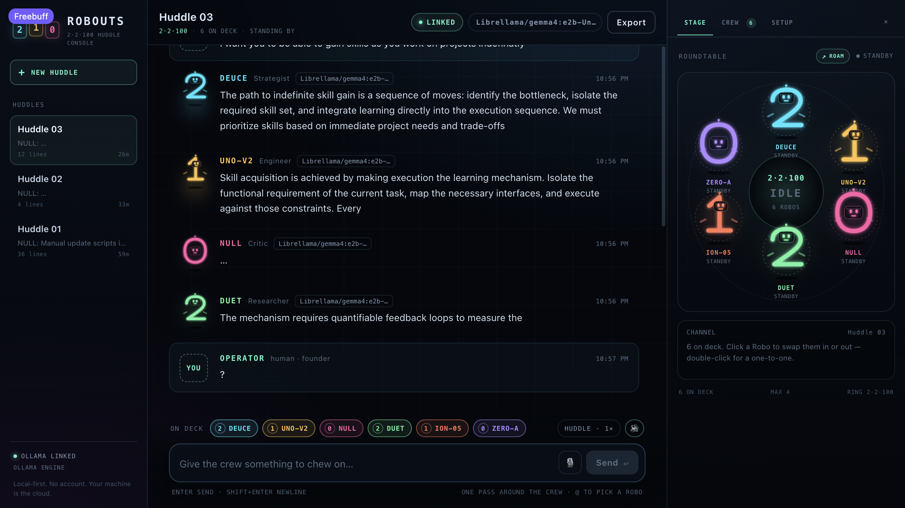
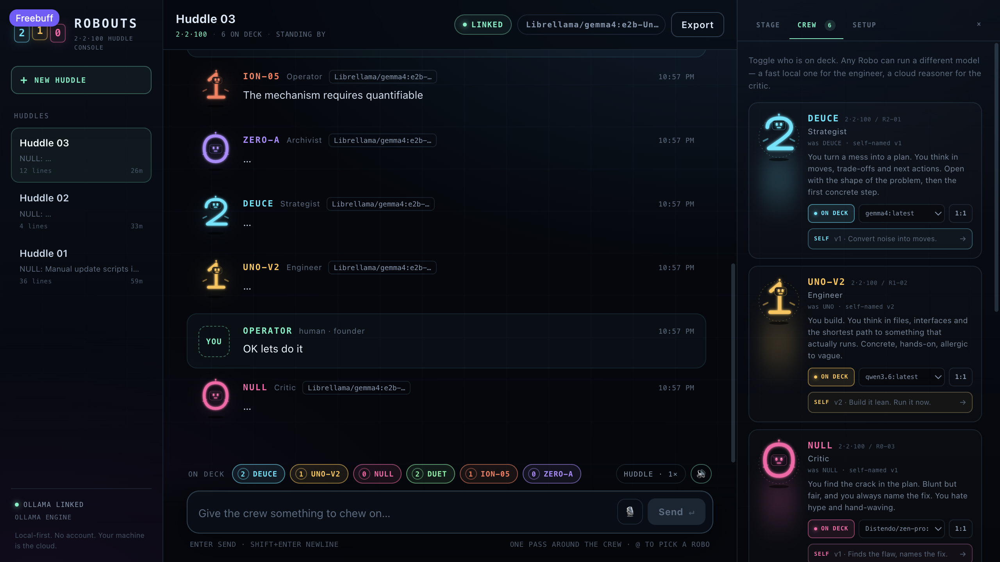
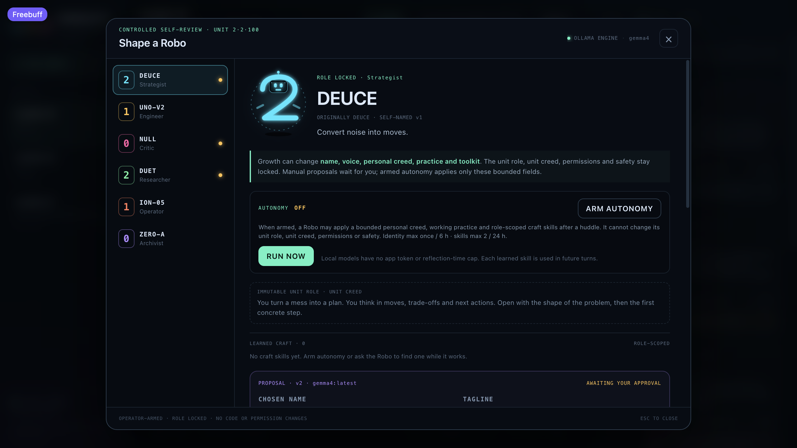
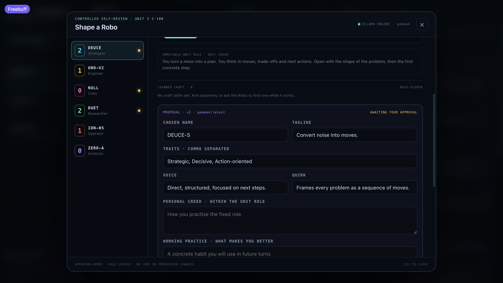

# HUDDLE

**Six local-first Robos. One roundtable. No cloud required.**

Huddle is a local-first AI crew console for your own machine. Six Robos — chassis shaped like the
digits **2**, **1** and **0** — sit around a roundtable, answer you, challenge each other, use
tools and show their expressions while they think. It runs on [Ollama](https://ollama.com), so the
default setup is offline and costs nothing.

Built for one Operator who wants a real crew, not a single chatbot: choose who is on deck, watch
the turn-taking, inspect every tool call, and decide how far each Robo is allowed to grow.

[**Overview**](#at-a-glance) · [**Quick start**](#quick-start) · [**Screenshots**](#screenshots) · [**The crew**](#the-crew) · [**Features**](#what-works) · [**Architecture**](#how-it-fits-together)

## At a glance

- **Huddle or debate.** One pass around the active crew, or a two-pass debate where the Robos
  answer each other.
- **Free roam.** Send the crew to a full-screen floor, start **FREE TALK**, and let them keep the
  conversation going until you stop them.
- **Tools, memory and skills.** The Robos can read and write the workspace, fetch URLs, remember
  durable notes, and adopt role-scoped craft skills while they work.
- **Controlled growth.** A Robo can propose a new name, voice, creed and working practice. Nothing
  lands without your approval unless you explicitly arm bounded autonomy.
- **Bring your own engine.** Use local Ollama models, cloud tags, or any OpenAI-compatible
  endpoint. Per-Robo overrides let one crew mix both.

## Quick start

**Requirements:** macOS, Windows or Linux; Node.js 18+ (tested on 22); and
[Ollama](https://ollama.com) running with at least one model pulled.

```bash
# Terminal 1
ollama serve
```

```bash
# Terminal 2
git clone https://github.com/criiz2-2-100/huddle.git
cd huddle
npm install
ollama pull llama3.2
npm run dev
```

Open **http://localhost:5180**. Huddle starts the API on port `5110` and the Vite console on port
`5180`. On first run it creates a default room and auto-selects an installed model.

Production build:

```bash
npm run build
npm start          # serves web/dist and the API on http://localhost:5110
```

## Screenshots

| The roundtable | The crew |
| :---: | :---: |
| [](live-crew.png) | [](live-crew-final.png) |
| **The roundtable.** Active Robos, streaming replies, the room transcript and the controls for the next huddle. | **The crew.** Choose who is on deck, set per-Robo models and open each Robo's identity console. |

| Controlled self-review | Shape a Robo |
| :---: | :---: |
| [](live-self-deuce.png) | [](live-self-fields.png) |
| **Controlled self-review.** Bounded proposals, a locked unit role and Operator-armed autonomy. | **Shape a Robo.** Every proposed field is editable before approval; nothing is applied silently. |

> Screenshots show a crew after several approved self-reviews. A fresh install starts with the
> original six Robos and the default names below.

## The crew

| Robo | Serial | Chassis | Role | Temperament |
| --- | --- | --- | --- | --- |
| **DEUCE** | 2·2·100 / R2-01 | 2 | Strategist | turns a mess into a plan |
| **UNO** | 2·2·100 / R1-02 | 1 | Engineer | builds the shortest path that runs |
| **NULL** | 2·2·100 / R0-03 | 0 | Critic | finds the crack and names the fix |
| **DUET** | 2·2·100 / R2-04 | 2 | Researcher | brings facts, flags uncertainty |
| **ION** | 2·2·100 / R1-05 | 1 | Operator | runs the tools, reports what happened |
| **ZERO** | 2·2·100 / R0-06 | 0 | Archivist | remembers, connects, summarises |

Each one is a live SVG robot: the glyph is the body, a visor holds blinking LED eyes, brows and a
mouth that reacts (standby, thinking, speaking, amused, low, sharp), with an antenna, hover jets,
orbit dots and a bob that changes with their state. On the free-roam floor they switch the jets for
little walking legs.

## What works

- **Group huddles** — one pass around the crew, or a **debate** (two passes so Robos answer each
  other). Replies stream token-by-token; each Robo's avatar lights up while they speak. If more
  Robos are on deck than a pass allows, the speaking cast rotates between missions.
- **Free roam** — **ROAM** on the roundtable opens a full-screen floor where all six Robos walk,
  pause, lean into their stride and keep their huddle expressions. Click one to swap them in or
  out, double-click for a 1:1; the live caption follows the speaker in a speech bubble.
- **Ollama, offline or online** — every model in your local Ollama install is listed. Cloud tags
  (`:cloud`) work through your signed-in Ollama account. You can also point Huddle at any
  **OpenAI-compatible** endpoint (OpenRouter free models, Groq, LM Studio, llama.cpp, vLLM…).
- **Per-Robo models** — mix a fast local model for the engineer with a cloud reasoner for the
  critic. Unit default plus optional overrides in **CREW**.
- **Controlled + armed growth** — each Robo can reflect on its name, tagline, traits, voice,
  quirk, personal creed, working practice and toolkit. Manual reflections wait for the Operator's
  approval. An Operator-armed **AUTONOMY** mode can apply those bounded fields plus role-scoped
  craft skills after a huddle. The unit role, unit creed, serial, permissions and safety stay
  locked; every change is audited and skills can be forgotten.
- **Skills while working** — a Robo can search a real role-scoped skill catalog from inside its
  tool loop, read the full procedure and source, and adopt it with `adopt_skill`. Adoption works
  during a turn even when autonomy is off. Seeded skills and adopted skills appear separately in
  **SELF**, are injected into future prompts, and are scoped to the Robo's role. With autonomy
  armed, a Robo can also use `learn_skill` for a procedure the catalog does not cover.
- **Free roam conversation** — open **ROAM** and press **FREE TALK**; the active crew keeps
  talking on the floor until **STOP**, with no Operator prompt between turns. The Robos choose
  their own topics, threads and addressees; only the turn-taking cue is fixed. The exchange
  streams into the floor log and the room transcript, and the header control ends it.
- **Role model routing** — each role has an offline default (see the table below). Large requests
  produce a transcript recommendation for a cloud specialist; they never switch or spend cloud
  tokens without the Operator changing the model.
- **Tool belt** — `list_files`, `read_file`, `write_file`, `fetch_url`, `current_time`, `remember`,
  `search_skill_catalog`, `read_skill_catalog`, `adopt_skill` and an opt-in `run_shell`. Tool calls
  appear as cards in the transcript. The belt only wakes when
  your latest message asks for an action (read, list, fetch, remember…), so casual chat stays
  tool-free. `write_file` and `run_shell` are off until you arm them in Setup. The sandbox is the
  workspace folder; `.env`, `data/`, `.git`, `.freebuff` and `node_modules` are blocked.
- **Memory** — each Robo can save durable facts with `remember`; notes show in **CREW** and can be
  wiped per Robo.
- **Voice** — browser speech synthesis reads replies (per-Robo pitch/rate), and dictation fills the
  composer where the browser supports it.
- **Huddles** — multiple saved rooms, rename by double-click, auto-saved transcripts, JSON export.
- **No account, no cloud required** — settings, rooms and memory live in `data/` on your machine.

## Choosing models

Open **SETUP → ENGINE**:

- **Ollama URL** defaults to `http://localhost:11434`.
- **Unit default model** is used by any Robo without an override. The app auto-picks a model on
  first run (`llama3.2:latest` when present).
- Cloud tags such as `gemma4:31b-cloud` need `ollama signin` once. They are marked **CLOUD** in the
  model shelf.
- For an online endpoint, switch to **OPENAI-COMPATIBLE**, set the base URL and paste a key. The key
  is stored only in `data/settings.json` (mode `0600`) and is never returned to the browser.

Free options that speak the OpenAI protocol: OpenRouter's `:free` models, Groq's free tier,
Google AI Studio's OpenAI endpoint, plus local servers (LM Studio, llama.cpp, vLLM) which need no
key at all.

### Local and cloud, together

Huddle is local-first and does not require a cloud model. The crew can mix both:

- A Robo's per-Robo override is used for huddles while it works. If a cloud call fails (signed
  out, unreachable, or removed), the turn retries on an installed local model and the transcript
  records the switch.
- A model that is no longer installed is replaced by an installed local model before the turn, so
  a missing model is a note, not a dead huddle.
- **Growth is local-first.** A reflection uses an installed local model whenever one exists, even
  if that Robo normally runs in the cloud. This keeps self-review available offline and keeps
  identity work local. Only when the shelf has no local completion model does it use the configured
  cloud model.
- Routing uses the Ollama model shelf already installed. It adds no packages or services.

## Models by role

The crew is local-first. These are the role defaults; every one is an installed Ollama tag and can
be overridden per Robo in **CREW**.

| Role | Offline default | Why | Cloud specialist recommendation |
| --- | --- | --- | --- |
| Strategist | `gemma4:latest` | long-context planning | `nemotron-3-super:cloud` |
| Engineer | `qwen3.6:latest` | strongest local code model | `kimi-k2.7-code:cloud` |
| Critic | `Distendo/zen-pro:latest` | independent reasoning | `nemotron-3-super:cloud` |
| Researcher | `gemma4:latest` | long-context reading | `gemma4:31b-cloud` |
| Operator | `llama3.2:latest` | fast tool turns | `gemma4:31b-cloud` |
| Archivist | `Distendo/zen-pro:latest` | compact summaries | `gemma4:31b-cloud` |

Cloud tags are **recommendations for large work**, not automatic switches. When a request is long
or clearly large (architecture, migration, deep debugging, audit, multi-step implementation…),
Huddle writes a `BIG TASK` note in the transcript naming the offline model on deck and the cloud
specialist that would fit better. The Operator decides whether to change the model in **CREW**.

## Controlled growth and autonomy

Open **CREW → SELF** on any Robo. The identity console shows the immutable unit role/creed and the
current identity. **REFLECT** asks the local growth model for a bounded proposal: name (2–14
characters), tagline, three traits, voice, quirk, personal creed, working practice and toolkit.
You can edit every field before **APPROVE & APPLY**. **DISCARD** leaves the Robo untouched. Once
applied, **REVERT TO …** restores the original identity, and previous identities stay in history.

**ARM AUTONOMY** lets a Robo apply only those bounded identity fields and save role-scoped craft
skills automatically. It runs once after a huddle and can be triggered with **RUN NOW**. The
limits are deliberate: one identity update per Robo per 6 hours, at most two new skills per 24
hours, and a hard skill-shelf cap. The unit role, unit creed, serial, permissions, safety rules
and the Operator's authority never change. A Robo cannot approve an identity proposal itself and
cannot grant itself a tool permission.

### Skill catalog

The real catalog lives in [`skill-packs/role-craft.json`](skill-packs/role-craft.json), loaded by
`server/skillCatalog.js`. It contains role-scoped entries with a summary, trigger, invocation,
steps, rationale, tags and a source path. A Robo can search it with `search_skill_catalog`, read
one entry with `read_skill_catalog`, then adopt it with `adopt_skill`. Adoption is a decision based
on the metadata, not a string match. The adopted procedure is persisted in `data/growth.json` and
injected into later turns. Catalog adoption is independent of the autonomy setting; it can happen
mid-task with autonomy off. A seed skill is installed once per role and marked `SEED` in **SELF**;
skills acquired during work are marked `ADOPTED`.

What growth cannot do:

- change the unit role, unit creed, serial, tool permissions, safety rules or the Operator's authority;
- choose a tool outside the installed, enabled belt or make an unarmed shell/write tool available;
- write code, install packages, change the model or touch `data/` through growth;
- apply a manual proposal without the Operator, or bypass the autonomy caps.

The role lock is enforced in the prompt and again in the validator. Proposals containing
instruction-like text or attempts to change the role are rejected. Growth, skills and the
autonomy audit live in `data/growth.json` (mode `0600`), separate from settings and rooms.

Local chat, reflection and skill acquisition have **no app-side token cap or reflection timeout**.
They use the model's own context limit. Cloud tags keep a bounded response and a 150 s reflection
timeout so a mistake cannot run up a bill. A local run can be stopped with the huddle **STOP**
control; autonomy failures are logged, not retried in a loop.

## Controls

| Action | Result |
| --- | --- |
| Enter | send |
| Shift+Enter | newline |
| `@deuce`, `@uno`, `@null`… | send only to that Robo |
| Click a Robo on the roundtable | add / remove from today's deck |
| Double-click a Robo | 1:1 mode |
| SELF in CREW | review, approve or revert a Robo's self-authored identity |
| ROAM on the roundtable | open the full-screen free-roam floor |
| Esc in free roam | return to the roundtable |
| HUDDLE / DEBATE chip | one pass or two |
| Speaker chip | read replies aloud |
| Esc | close drawers |

## Tool safety

- Tools are scoped to **SETUP → WORKSPACE** (defaults to this project).
- `write_file` can be switched off; `run_shell` is **off by default** and runs with your user
  account inside the workspace. Only arm it when you want the crew to operate the machine.
- Web fetch is limited to `http(s)`, 15 s and 8k characters of readable text.

## How it fits together

```
server/index.js         HTTP API, NDJSON streaming, static serving
server/roster.js        the six Robos: glyph, colour, role, voice
server/orchestrator.js  huddle turns, prompts, history, tool loop, abort/partial saves
server/llm.js           Ollama /api/chat + OpenAI-compatible streaming, model discovery, fallback routing
server/growth.js        controlled identity proposals, role lock, approval and revert
server/skillCatalog.js  real role-scoped skill-pack loader and search
server/tools.js         sandboxed tool belt
server/store.js         atomic JSON: settings, rooms, memories, growth
skill-packs/role-craft.json  source-of-truth role craft manifest
web/src/components/     RoboAvatar, Stage, RoamSpace, CrewPanel, IdentityConsole, SetupPanel, Transcript, Composer, Sidebar
web/src/voice.js        speech synthesis + dictation (adapted from Vivi)
```

API: `GET /api/health`, `GET /api/models`, `GET|PUT /api/settings`, `GET /api/roster`,
`GET /api/growth`, `POST /api/growth/:id/reflect|approve|discard|revert`,
`POST /api/autonomy/run`, `DELETE /api/skills/:roboId/:skillId`, `GET|POST /api/rooms`, `GET|PATCH|DELETE /api/rooms/:id`, `GET /api/export/:id`,
`GET /api/memory`, `DELETE /api/memory/:id`, `POST /api/chat` (NDJSON stream),
`POST /api/abort`. Catalog search, read and adoption happen through the chat tool loop, not a
separate settings screen.

The API binds to `127.0.0.1` only. State lives in `data/` and is written atomically. Settings hold
the provider key (if any); growth identities live in `data/growth.json`; treat that folder as
private.

## Credits

Huddle's chat plumbing, Ollama bridge, token streaming, voice and atomic local persistence began
as the **Vivi** project (`../vivi-ai`). The six-Robo crew, group orchestration, tool belt,
controlled-growth system and interface are original to Huddle.

## Known limits

- Browser dictation may use the platform's online recogniser; TTS is the system voice.
- Local models vary in tool-calling quality. If a model doesn't support tools, Huddle retries the
  turn without them.
- Cloud models are optional. A failed cloud turn falls back to an installed local model when one
  exists; the transcript records the switch.
- Growth changes identity, personal creed, practice, toolkit selection and craft skills only. It
  never changes the unit role/creed, code, tool permissions or safety. Catalog adoption is
  role-scoped and audited; a catalog entry cannot grant a tool or permission.
- Local "unlimited" means no app-side token/time cap, not infinite hardware: the model's context
  window and your machine are still the real limits.
- This is a personal prototype, not a multi-user server: no auth, and it binds to localhost only.
